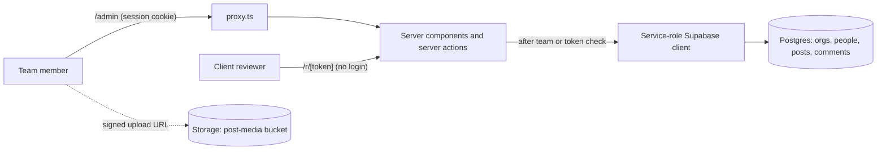

# Post Reviewer

Show clients how their upcoming LinkedIn posts will look, and collect their edits and approvals in one place.

## The problem

Teams that write LinkedIn posts on behalf of founders and executives usually send drafts as docs or screenshots. The client can't see where the text will cut off at "…more" or how an image grid or document carousel will look. Feedback ends up spread across email and chat, and it's hard to tell which comment belongs to which draft.

Post Reviewer gives each client one link. It shows their posts as LinkedIn-style previews, and keeps comments and approvals next to each post.

## Features

- **Orgs, people, posts.** Each client org has several people (name, headline, photo, LinkedIn URL). Each person has their own posts.
- **LinkedIn-style preview.** Profile header, 3-line truncation with "…more", and highlighted `#hashtags`, `@[Full Name]` mentions and links. Desktop (555 px) and mobile (390 px) widths.
- **Every attachment type LinkedIn posts use:**
  - Image grid with LinkedIn's layouts for 1, 2, 3–4 and 5+ images (with a "+N" overlay), up to 20 images.
  - Video with a player.
  - Document carousel, with pages uploaded as images and page-by-page navigation.
  - Link card. The server fetches the page's Open Graph title and image.
  - Poll with 2–4 options and a 1 day to 2 week duration.
- **Client review link** at `/r/<token>`. One per org, no login, marked `noindex`. Drafts are never shown.
  - Filter by person, or by "To review", "Approved" and "All".
  - Select any text in a post to comment on that exact passage, or leave a general note.
  - **Approve** or **Request changes** (a note is required for changes). Each decision is logged as a comment.
  - The reviewer types their name once. It is remembered in that browser.
- **Team workspace** at `/admin`, behind email and password sign-in.
  - Client list with counts of posts awaiting the client and posts that need edits.
  - Post editor with a live preview, a 3,000-character counter, status, and a scheduled date and time.
  - `Cmd/Ctrl+S` saves. The browser warns before leaving with unsaved changes.
  - Reply to, resolve and reopen comments.
- **Revision tracking.** Editing a post's text or media bumps its version. Older comments are tagged "on v2" so the team can see which feedback predates a change.
- **Link reset.** Rotating an org's share token stops the old link working.
- **Direct uploads.** Images, videos and avatars go from the browser straight to Supabase Storage with one-time signed upload URLs, so large files don't pass through the server.
- **Local times.** Schedules and comment times render in each viewer's own timezone.

## How it works

The app is a Next.js App Router project. Pages are server components, and every database write goes through a server action.

The database is locked down. Every table has Row Level Security enabled with no policies, and the `anon` and `authenticated` roles have no grants. All reads and writes run on the server with the Supabase service-role client, after one of two checks:

1. **Team routes.** The user has a valid Supabase Auth session *and* has a row in `team_members`. Signing up alone grants nothing.
2. **Client routes.** The request carries a valid org share token. Each client action also checks that the post belongs to that org and is not a draft.

`src/proxy.ts` (Next.js 16's replacement for `middleware.ts`) refreshes the auth session on `/admin` routes and sends signed-out users to `/login`.



Data model: `orgs` (each with a unique `share_token`) → `people` → `posts` → `comments`. A post stores its attachment in one JSONB `media` field whose `kind` is `none`, `images`, `video`, `document`, `link` or `poll`. A post's status is `draft`, `in_review`, `changes_requested`, `approved` or `posted`. Each comment records the post version it was written on, plus an optional quoted passage.

## Tech stack

- Next.js 16 (App Router, server actions, `proxy.ts`), React 19, TypeScript
- Tailwind CSS 4, lucide-react icons
- Supabase: Postgres, Auth (email and password) and Storage, via `@supabase/supabase-js` and `@supabase/ssr`
- ESLint (`eslint-config-next`)
- Originally deployed on Vercel. There is no Vercel-specific config in the repo.

## Getting started

### Prerequisites

- Node.js 22 or newer. `@supabase/supabase-js` needs the native WebSocket that ships with Node 22.
- A Supabase project.
- `psql`, or access to the Supabase SQL editor, to run the schema.

### 1. Install

```bash
npm install
```

### 2. Environment variables

```bash
cp .env.example .env.local
```

| Variable | Where to get it |
| --- | --- |
| `NEXT_PUBLIC_SUPABASE_URL` | Your project URL, from the Supabase dashboard (Project Settings, or the **Connect** panel). |
| `NEXT_PUBLIC_SUPABASE_PUBLISHABLE_KEY` | Project Settings → API Keys. The publishable key. |
| `SUPABASE_URL` | The same project URL. Read by server-only code and the team-member script. |
| `SUPABASE_SERVICE_ROLE_KEY` | Project Settings → API Keys. The service-role (secret) key. Server only: it bypasses RLS. |
| `POSTGRES_URL_NON_POOLING` | Optional. **Connect** panel → direct connection string. Only used by the `psql` commands below. |

These names match the variables the Supabase integration on the Vercel Marketplace creates. If you use that integration, `vercel env pull .env.local` fills them in.

### 3. Create the schema

Run the migration with `psql`, or paste the file into the Supabase SQL editor:

```bash
psql "$POSTGRES_URL_NON_POOLING" -f supabase/migrations/0001_init.sql
```

`psql` doesn't read `.env.local`, so export the variable first or paste the connection string inline.

The migration creates the tables and indexes, enables RLS, removes `anon`/`authenticated` access, and creates a public `post-media` Storage bucket.

### 4. Add a team member

There is no sign-up page. Team accounts are created with a script that reads `.env.local`:

```bash
npm run add-team-member -- you@example.com 'a-strong-password'
```

It creates the Supabase Auth user and adds it to `team_members`. If the user already exists, it reuses that account and resets the password when you pass one.

### 5. Optional demo data

```bash
psql "$POSTGRES_URL_NON_POOLING" -f supabase/seed-demo.sql
```

This creates a fictional "Demo Co" org with two people and three posts: an image post and a poll waiting for review, and one hidden draft. Running it again replaces Demo Co.

### 6. Run

```bash
npm run dev      # http://localhost:3000 → /admin (redirects to /login when signed out)
npm run build    # production build
npm start        # serve the production build
npm run lint     # ESLint
```

### Using it

1. In `/admin`, add a client org, then add its people.
2. Click **New post** next to a person. Write it, attach media, and click **Save & send for review**.
3. Copy the org's review link from the org page and send it to the client.
4. Reply to and resolve their comments in the editor. The client sees the new revision at the same link.

## Project structure

```
src/
  app/
    admin/              Team workspace: client list, org page, post editor, server actions
    r/[token]/          Client review page and its token-checked server actions
    login/              Team sign-in
  components/
    linkedin/           LinkedInPost: the feed-post preview and attachment layouts
    admin/              Forms and buttons used only in the workspace
    ReviewPanel.tsx     Comment thread, quote-to-comment, approve / request changes
  lib/
    supabase/           Service-role, cookie-based server, and browser clients
    auth.ts             Team-member and share-token checks
    data.ts, types.ts   Shared queries and types
  proxy.ts              Session refresh and /admin → /login redirect
supabase/
  migrations/           Schema, RLS lockdown, storage bucket
  seed-demo.sql         Optional fictional demo data
scripts/
  create-team-member.mjs
```

## Status and limitations

This is a working prototype built around one small team's review workflow. Known gaps:

- **No automated tests.**
- **It does not publish to LinkedIn.** "Scheduled for" and "Posted" are tracking fields only. Nothing connects to the LinkedIn API.
- **The preview is a hand-built approximation** of a LinkedIn feed post, not pixel-perfect. It can drift as LinkedIn changes its UI. The like/comment/repost bar is static, and poll votes only work locally in the preview.
- **No notifications.** Nobody is emailed when a post is ready or gets a comment. The team shares the link by hand.
- **Review links are bearer links.** Anyone with the link can read non-draft posts, comment and approve. The reviewer's name is self-reported. Resetting the link is the only way to revoke access.
- **No roles or invites.** Every team member sees every org, and accounts are created from the command line.
- **Documents must be uploaded as page images.** There is no PDF-to-image conversion.
- **Media is public and never cleaned up.** The `post-media` bucket is public, so anyone with a file's URL can open it. Deleting a post or removing an image doesn't delete the file from Storage.
- **Link previews fetch any http(s) URL** a signed-in team member enters. There is no allow-list.

Not affiliated with or endorsed by LinkedIn.
